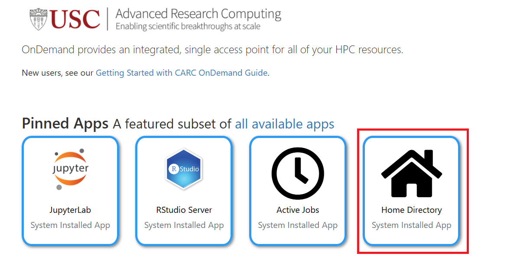
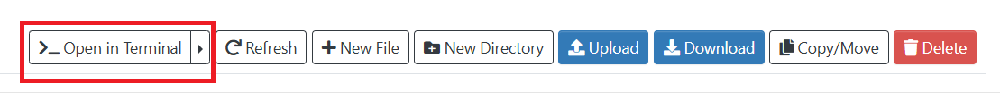

# HPC Instructions

## Discovery cluster information 
We will use CARC’s general-use HPC cluster "Discovery".

There are 2 ways to access this cluster: 
- SSH to the Discovery Cluster: You need to SSH from your terminal to the remote cluster. Please read the following [guide](https://www.carc.usc.edu/user-guides/hpc-systems/discovery/getting-started-discovery).
- OnDemand: This provides a graphical, browser-based access. Please read the following [guide](https://www.carc.usc.edu/user-guides/carc-ondemand/ondemand-overview).

## Connect to the USC network or Research VPN. [guide](https://www.carc.usc.edu/user-guides/hpc-systems/discovery/getting-started-discovery#connecting-to-the-usc-network-or-research-vpn)
You will have to either be connected to the `USC Secure Wireless` network or use the [USC VPN](https://www.carc.usc.edu/user-guides/quick-start-guides/anyconnect-vpn-setup) to connect to the cluster.

## Log in to Discovery node and access the terminal:
There are 2 ways:
- SSH to the Discovery Cluster: from a terminal on your own machine, run the following (replace `<netid>` with your USC NetID; you will be asked for your password and Duo). Refer to the [instructions](https://www.carc.usc.edu/user-guides/hpc-systems/discovery/getting-started-discovery#logging-in) for OS-specific details.
    ```shell
    $ ssh <netid>@discovery.usc.edu
    ```
- OnDemand: 
    1. Use this [link](https://ondemand.carc.usc.edu/) to login using USC NetID.
    2. Click on 
    3. Open the  in the Home Directory. 
    
In both ways, you should get `[username@discovery* ~]` prompt in the terminal.

**Note: It is important to be familiar with how to use the shell for each case, and also how to transfer files.**

## Conventions:
In the rest of the document, we will assume the following convention:

- In code blocks, lines that start with `$` are shell commands. Copy the text after the `$`.
- In code blocks, lines that start with `#` are either outputs or comments.
- Output code in `<...>` are placeholders. In output lines that start with `#` just refers to text we don't necessarily care about.

## Initial Setup:

Before you can run the experiments, you will have to setup the environment for the HPC.

### Python/Anaconda setup

Run the following in the shell:

```shell
$ module purge
$ module load conda
$ conda init bash
$ conda config --set auto_activate false # This will prevent the base environment from being loaded
$ source ~/.bashrc
```

**Note:** If you later see an error like `MultipleKeysError: Multiple aliased keys in file ~/.condarc: auto_activate_base, auto_activate`, your `~/.condarc` has both the old and new names of this setting. Remove the old one and retry:

```shell
$ sed -i '/auto_activate_base/d' ~/.condarc
```

**Note:** If you later see an error like `MultipleKeysError: Multiple aliased keys in file ~/.condarc: auto_activate_base, auto_activate`, your `~/.condarc` has both the old and new names of this setting. Remove the old one and retry:

```shell
$ sed -i '/auto_activate_base/d' ~/.condarc
```

This will load the [Anaconda](https://docs.conda.io/en/latest/) module. So, you will have to create your own environment:

```shell
$ conda activate base
$ conda create -n carla python=3.8 conda -c conda-forge
$ ~/.conda/envs/carla/condabin/conda init bash # Singularity env is unable to load the conda installed on HPC. This changes it to the conda installed in the carla environment
```

This will create the `carla` environment with Python 3.8. To use this environment, run:

```shell
$ source ~/.bashrc
$ conda activate ~/.conda/envs/carla
```

**Note:** Always activate the environment by its full path as shown above, not with `conda activate carla`. After the `conda init` step above, your shell uses the conda that lives *inside* the `carla` environment, which considers that environment to be its own `base`. Because of this, the prompt will show `(base)` rather than `(carla)`, and `conda activate carla` will silently do nothing. That is expected.

To verify that you have the correct environment loaded, make sure the following commands output correctly (the prompt prefix is not a reliable indicator):

```shell
$ python --version
# Python 3.8.<*>
$ which python
# ~/.conda/envs/carla/bin/python
```

### Code transfer

First, get the template for the project:

```shell
$ cd ~
$ cp /project2/jdeshmuk_786/csci513-miniproject1.zip .
$ unzip csci513-miniproject1.zip
```

This will create a `csci513-miniproject1` directory in your home directory.
You can use the file transfer methods described in the linked guides above to update the controller in this directory with your code as needed.

### Acquire a compute node

Run the following command to acquire a compute "node" with a GPU:

```shell
$ salloc --time=2:00:00 --cpus-per-task=8 --mem=32GB --account=jdeshmuk_786 --partition=gpu --gres=gpu:1
# salloc: Granted job allocation <job id>
# salloc: Waiting for resource configuration
# salloc: Nodes <node-name> are ready for job
```

Run the command `nvidia-smi` to ensure the GPU drivers were loaded properly:

```shell
$ nvidia-smi
```

### Carla setup

```shell
$ module load apptainer
$ source ~/.bashrc
$ conda activate ~/.conda/envs/carla
```

We will be using [`Singularity`](https://docs.sylabs.io/guides/3.7/user-guide/index.html) to run CARLA within a container.
Now, launch the singularity container:

```shell
$ singularity exec --nv /project2/jdeshmuk_786/carla-0.9.15_4.11.sif bash
```

When you run this, your prompt should change to `Apptainer>`. Then, run the following to install the required Python library.

```shell
$ source ~/.bashrc
$ conda activate ~/.conda/envs/carla # Verify with `which python` (prompt will show (base), that is expected)
$ pip install -U carla==0.9.15
```

```shell
$ cd ~/csci513-miniproject1
$ python3 -m pip install -U -e .
```

Now, we will try to run Carla and verify that it works.
Run the following while still inside the Singularity container:

```shell
$ cd /home/carla/ # This will change directories to the specified one
$ bash ./CarlaUE4.sh -nosound -vulkan -RenderOffScreen & # The & is required
# chmod: changing permissions of '/home/carla/CarlaUE4/Binaries/Linux/CarlaUE4-Linux-Shipping': Read-only file system
# 4.26.2-0+++UE4+Release-4.26 522 0
# Disabling core dumps.

# Hit ENTER here and the prompt will reappear. If it doesnt, make sure that you put in the &
$ cd PythonAPI/util
$ python3 test_connection.py
# CARLA 0.9.15 connected at 127.0.0.1:2000.
```

If you don't see the last output, then there is an issue.

**Note: To exit from the Singularity container and/or the allocated job node, simply run the command `exit`.**

You can exit the container and the job node now (you will have to run `exit` twice: once for the container, once for the job node).

## Running the experiment

First get a job allocation using `salloc`:

```shell
$ salloc --time=2:00:00 --cpus-per-task=8 --mem=32GB --account=jdeshmuk_786 --partition=gpu --gres=gpu:1
# salloc: Granted job allocation <job id>
# salloc: Waiting for resource configuration
# salloc: Nodes <node-name> are ready for job
```

Once you're allocated a node (based on the output above), you will run the following:

```shell
$ module load apptainer
$ source ~/.bashrc
$ singularity exec --nv /project2/jdeshmuk_786/carla-0.9.15_4.11.sif bash # You will get into the singularity container
$ source ~/.bashrc
$ conda activate ~/.conda/envs/carla # Verify with `which python` (prompt will show (base), that is expected)
$ bash /home/carla/CarlaUE4.sh -nosound -vulkan -RenderOffScreen & # This will launch Carla. Remember to hit ENTER after seeing the desired output to get the prompt back.
$ cd ~/csci513-miniproject1
```

Now, you should be able to run your simulations and evaluate your designs as
described in the README file (follow the instructions after the Carla server has
been started).

```shell
$ python3 -m mp1_simulator test_data/* # Example controller
```
This will run the example controller provided in `controller.py`. 

## Work on your controller
You need to design your controller in `mp1_controller/controller.py`.

Your home directory is the same filesystem on the login node, on the GPU node, and inside the Singularity container, and the project was installed in editable mode (`pip install -e .`). This means any change you save to `controller.py` takes effect the next time you run the simulator, with no reinstall needed, regardless of where you edited it.

The recommended workflow uses two terminals:

1) **Terminal 1 (simulation):** log in, run `salloc`, enter the container, and start CARLA as described above. Keep this terminal for running `python3 -m mp1_simulator ...` and `python3 -m mp1_evaluation ...`.

2) **Terminal 2 (editing):** open a second login to Discovery (another `ssh` session or the OnDemand terminal/file editor) and edit `controller.py` there with `nano`, `vim`, or the OnDemand browser editor. See the CARC [instructions](https://www.carc.usc.edu/user-guides/hpc-systems/discovery/getting-started-discovery#creating-and-editing-text-files). VS Code with the *Remote - SSH* extension connected to `discovery.usc.edu` also works well.

Save in terminal 2, rerun the simulator in terminal 1, and repeat.

Alternatively, you can edit locally on your own machine and transfer the file to HPC each time. Refer to the [instructions](https://www.carc.usc.edu/user-guides/hpc-systems/discovery/getting-started-discovery#transferring-files). This works but is slower to iterate on.

**Note:** the GPU allocation from `salloc` expires after the requested time (2 hours in the examples above). Your files are not affected, but you will need to run `salloc` again and relaunch CARLA to continue simulating.